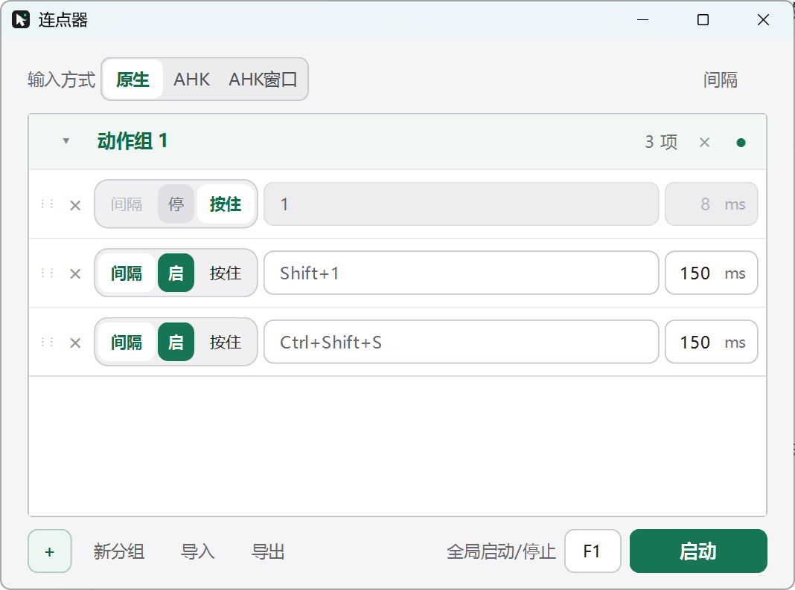
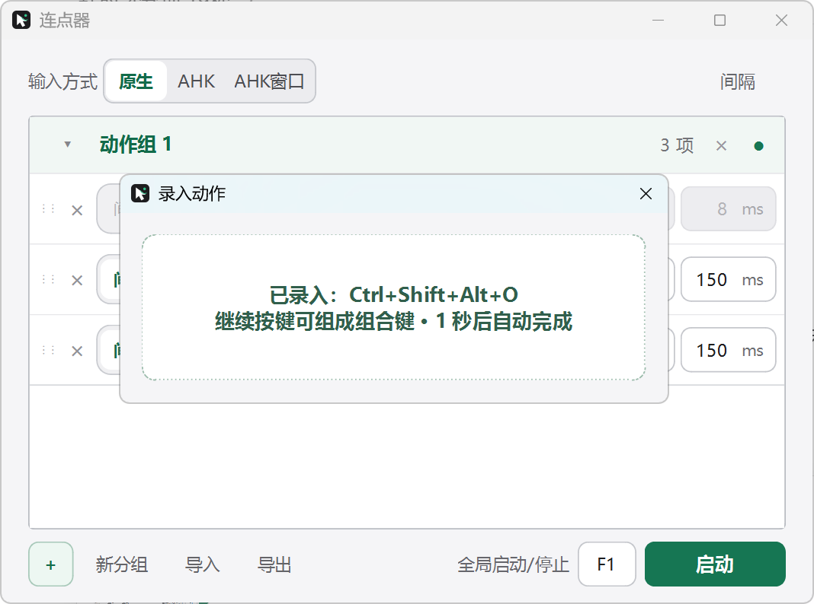
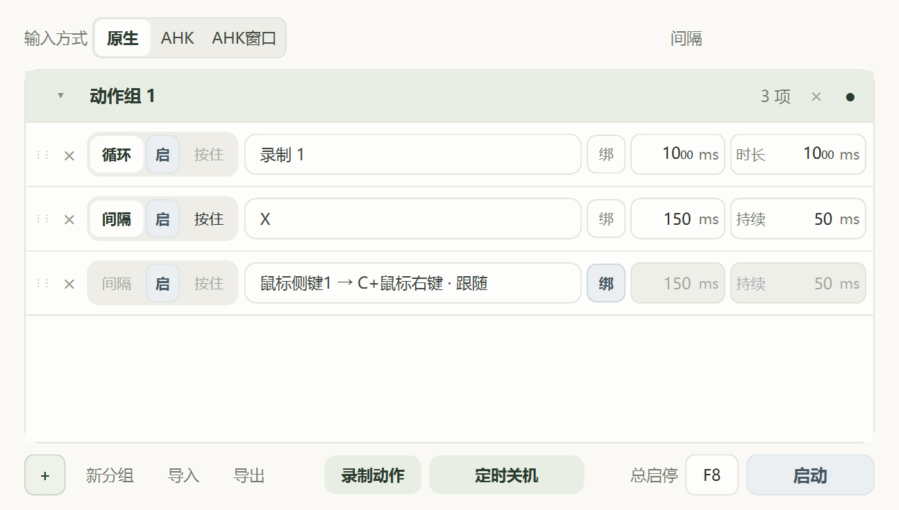
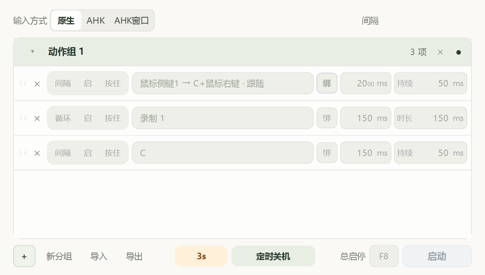
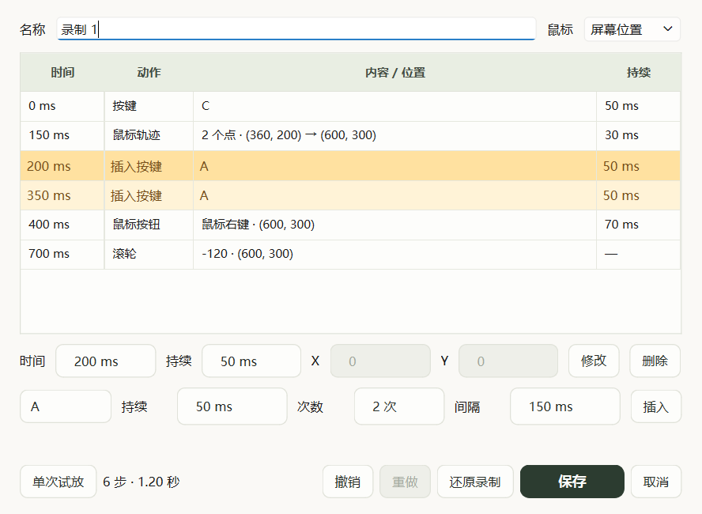
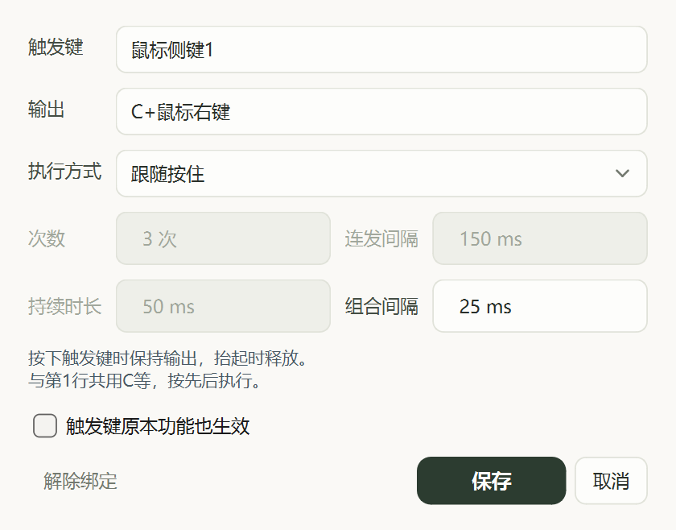

# 轻云连点器

当前正式版本：**V2.0**（`2.0.0`）。窗口显示“轻云连点器 — V2.0”，[下载 Windows 正式版](https://github.com/v-49/qingyun-clicker/releases/tag/v2.0.0)。本地可运行文件：`dist/QingyunClicker-v2.0.exe`。

一个支持自定义录入的 Windows 10/11 开源连点器。点击录入按钮后，直接按下键盘键、鼠标按钮或组合键，最后一次输入 1 秒后自动完成录入。

[下载最新版 Windows EXE](https://github.com/v-49/qingyun-clicker/releases/latest)



## 主要功能

- 自定义录入键盘、鼠标左/右/中键和两个侧键。
- 支持 `Ctrl+Shift+A`、`A+B`、`Shift+鼠标左键` 等组合动作。
- 每个动作可选择“按间隔重复”或“持续按住”。
- 原生模式支持逐行动作绑定：`X → X` 同键连发、`A → B` 改键、侧键触发键鼠组合。点动作右侧“绑”，在一个编辑框中直接录入触发键和输出、选择执行方式；不绑定时保留自动执行。
- 新建绑定默认跟随按住；已有绑定保留执行方式。绑定后左侧“间隔”和“按住”置灰，中间“启 / 停”控制这一条是否参与运行，编辑框不再放启停开关。停用后仍可编辑绑定，编辑或解除绑定保留本条启停状态；解除绑定恢复自动方式。
- 短连发默认 3 次，可设置 1–999 次；按一下触发键后完成固定次数。按住连发在抬起触发键时停止；组合持续按住在抬起时倒序释放。
- 输出组合可设置各键按下之间的间隔，例如先按 C、等待 25 ms、再按右键。等待期间松开触发键会取消未发送的后续按下。
- 间隔支持完整显示和编辑 1–99999 ms；末尾两个零在非编辑状态缩小显示，点击后恢复普通数字，修改自动保存。
- 每行“持续”支持0–99999 ms，放在间隔右侧，默认 50 ms，直接填写该行的点按时长。0 ms 为立即松开；持续按住不受该时长影响。新动作和未保存时长的旧配置使用 50 ms，已有明确数值保留。
- 底栏中间可直接填写小时与分钟设置关机（合计 1–10080 分钟），无上下箭头，显示剩余时间，再次点击取消；退出软件自动取消，重启不恢复关机任务。
- 动作可单独启停；尚未设置的空白动作会自动跳过。
- 自动行和绑定行停用时均按旧版置灰，不添加“已停用”文字；停用的绑定可从“绑”继续编辑。
- 拖动左侧 `⋮⋮` 调整列表顺序，并自动保存；完整先后步骤放在录制内部。
- 多动作组、JSON 导入/导出、全局启动/停止快捷键。
- F8 只启停当前组。自动行直接执行，绑定行等待物理触发；切换组先停止旧组，新组等待再次启动。
- 内置 Windows 原生 `SendInput`；可选 AutoHotkey v2 和窗口定向模式。
- 停止、异常或退出时会释放仍处于按下状态的按键。
- 点击底栏“录制动作”，原按钮显示 **3s → 2s → 1s**，随后开始采集全屏物理键鼠：按下/松开、扫描码、鼠标按钮、轨迹及横纵滚轮。准备期间的操作不收录，再次点击或按停止键可取消。切到游戏正常操作，F9 或原总启停快捷键立即停止，结果追加为当前组的一行。
- 最终通过 Alt+Tab 切回本软件并结束录制时，自动剪掉这次切窗及之后的返回过程与等待。中途切回软件后继续录制的操作保留；剪切点补齐仍按住的键，原始内容可通过“还原录制”恢复。鼠标直接返回时，保留切回前无法确定用途的移动，避免误删游戏操作。
- 录制行默认单次，点击“循环”开启整段循环；间隔是每轮结束后的等待，默认 1000 ms，右侧只读显示整段时长。“绑”可设置单次、指定次数或按住触发键期间循环。
- 点击录制名称查看时间与步骤，修改名称、按下时间、持续和点击坐标，删除步骤或插入按键/组合及有限次数连发。单次试放有 3 秒准备时间，总启停键可中断。
- 原录制步骤保持原样，插入步骤以浅橙底色和“插入按键 / 插入按钮”区分，保存后仍保留来源。编辑支持撤销、重做及“还原录制”：恢复编辑前的原始步骤和时间，移除插入与修改；还原也可撤销，保留当前名称和鼠标回放方式。
- 原生混合执行：不同输出同时运行，兼容的修饰键/长按共享持有状态；同键输出和争用鼠标位置的动作按轮次先后执行，当前完整动作结束后等待中的绑定优先。录制内部顺序与间隔保留，等待不补发积压。
- 单次录制结束后，其他间隔动作及绑定监听继续运行，直到总停止；录制和回放互斥，开始录制会先停止原执行。
- 同一行绑定后仅响应触发键；解绑恢复原自动模式。重复触发键、占用总启停键、自动长按导致无法轮换的配置仍会拦截，提示具体行号和按键。绑定编辑沿用原说明位置提示软冲突，不增加布局行。

## 自定义录入

点击某一行的“未设置按键”，然后按下一个或多个键。每次新输入都会重新开始 1 秒倒计时，因此既能录入单键，也能自然录入多键组合。



## 快速使用

1. 从 [Releases](https://github.com/v-49/qingyun-clicker/releases) 下载 `QingyunClicker-Windows-x64.exe`。
2. 启动后确认 Windows UAC 提示。程序以管理员权限运行，便于向同样以管理员权限运行的目标程序发送输入。
3. 点击左下角 `＋` 添加动作。
4. 点击“未设置按键”，完成自定义录入。
5. 设置间隔或按住模式，然后点击“启动”；默认全局快捷键为 `F8`。

配置保存在当前 Windows 用户的应用设置中，不会上传到网络。

V2.0 已接入全屏录制、组内保存、步骤编辑、单次/循环回放及序列绑定，与同组间隔动作共用调度器，并支持区分插入来源、还原录制、软冲突顺序协调、录制准备倒计时及可还原的结束剪尾。录制、绑定、短连发和组合间隔暂仅支持原生输入。实现与验证边界见 [同页录制说明](docs/fullscreen-recording-plan.md)，发布记录见 [V2.0 正式版](docs/v2-release.md)。





录制中不会弹出操作框。准备期间与软件窗口内的操作、生成的合成输入不进入录制；停止保存时补齐未松开的键，仅补记录，不向游戏发送输入。录制结束无延迟，游戏内按F9立即结束；切回软件结束时自动清理最后一次返回过程，并保留可还原的原始时间线。配置继续使用原存储身份，保留旧组和快捷键；含录制的导出为版本 2，旧版本 1 配置仍可导入。



鼠标默认按屏幕位置回放；游戏锁定/回中鼠标时，在录制编辑框选择“相对移动”。两种位移分开保存、择一回放。屏幕坐标回放要求虚拟桌面范围与录制一致。软件不保证绕过游戏对合成输入的过滤，WeGame 实际游戏尚未验证。

绑定行默认接管原始触发键，只输出配置动作。勾选“触发键原本功能也生效”时原始输入也会传递，例如侧键 → C 时侧键原功能与 C 都执行。同一行短连发执行期间忽略再次触发，系统键盘自动重复不新增一轮。本程序生成的输入不会触发其他绑定。



绑定设置依次为触发键、输出、执行方式。触发键录入单键或鼠标按钮后立即完成；输出允许连续录入组合，最后一次输入 1 秒后完成，Esc 取消当前录入。四个参数固定为两行，不适用的参数置灰，切换方式不改变弹框大小和按钮位置。原键功能选项直接显示，无需展开。说明与冲突提示共用固定位置。保存只修改配置，单条启停统一使用行内“启 / 停”，总开关启动当前组。

重复间隔是两次按下开始之间的时间。“持续”是一次点按保持多久。持续不小于间隔时，同一动作不会叠加执行，实际周期会延长到持续时间加松开阶段；其他动作继续各自调度。需要某个动作保持更久或更短时，直接修改该行数值。

构建脚本使用隔离的 DLL 搜索路径，防止其他开发工具的同名运行库混入。打包结束后自动将单个 EXE 复制到临时目录，以 Windows 原生界面启动、渲染并退出；通过后才算构建成功。启动测试使用独立配置，不注册热键，不执行点击或关机。

定时关机到期时先停止连点并保存配置，再请求 Windows 关机。程序不强制关闭其他应用，未保存文档可能阻止关机。关机倒计时需要保持本软件运行。

## 单文件与运行缓存

仍然只需下载一个 EXE。首次运行会将内置运行库释放到 `%LOCALAPPDATA%\QingyunClicker\runtime\<内容版本标识>\`；以后启动进行 SHA-256 完整校验并复用已有文件。缺失、内容损坏或出现额外文件时重新释放；空闲旧版本会清理，正在使用的版本会保留。

删除 EXE 不会自动删除缓存。在窗口空白处右键可选择“打开运行缓存目录”或“清理运行缓存并退出”。清理不删除原有动作配置，下次启动重新释放。也可通过 `轻云连点器.exe --clear-cache` 清理空闲运行缓存。

启动器使用 Windows 10/11 自带的 .NET Framework，Python/Qt 随 EXE 内置，无需另行安装 Python。首次解压较慢；本机单动作隔离配置测试首次约 3.44 秒，随后5次约0.82–0.87秒。该时间不含用户处理UAC提示，不代表其他电脑或重启后的冷启动保证。

包体已去除本应用未使用的 Qt PDF 图像插件、虚拟键盘及其 QML/Quick 依赖、软件 OpenGL；保留 Windows 平台、原生输入法和常用图像格式。PDF 插件是 Qt 自动收集的通用格式支持，本连点器没有 PDF 功能。

## 核心实现

- **录入模型**：把一次动作保存为有序输入单元列表，并单独记录 Ctrl、Shift、Alt、Win 修饰状态，兼容旧版单键配置。
- **组合键执行**：依次按下修饰键和动作键，停止或单次触发结束时按相反顺序释放，避免按键残留。
- **原生输入**：使用 Windows `SendInput`，键盘优先发送扫描码，鼠标使用对应按钮事件。
- **调度器**：独立线程基于单调时钟调度重复动作；停止事件可立即中断等待。
- **物理监听**：独立消息线程使用 Windows 低级键盘与鼠标钩子，仅真实输入进入绑定状态，回调向执行线程提交边沿事件。
- **录制剪尾**：原生前台窗口事件与物理 Alt+Tab 边沿共同确定最终返回软件的边界，按事件顺序剪切、补齐释放并保留原始时间线；不按固定秒数删除。
- **全局热键**：使用 `RegisterHotKey` 注册一个主键加可选修饰键；原生运行期间物理监听也识别停止键，避免输出中的修饰键影响停止。
- **AHK 后端**：可选调用 AutoHotkey v2；窗口模式使用 `ControlSend` / `ControlClick`。

## 兼容性边界

软件层输入不能保证在所有游戏中有效。目标程序可能读取 Raw Input、DirectInput，主动过滤合成事件，或由反作弊系统禁止自动化。请遵守目标软件和游戏规则；本项目不提供绕过反作弊或安全机制的能力。

## 从源码运行

```powershell
python -m venv .venv
.\.venv\Scripts\python.exe -m pip install -r requirements-dev.txt
.\.venv\Scripts\python.exe main.py
```

运行测试：

```powershell
.\.venv\Scripts\python.exe -m unittest -v
```

打包 Windows EXE：

```powershell
.\build_shell.ps1
```

输出文件位于 `dist\QingyunClicker-v2.0.exe`，并内置 `requireAdministrator` 清单，因此每次启动都会显示 UAC 确认。

## 开源许可

[MIT License](LICENSE)
